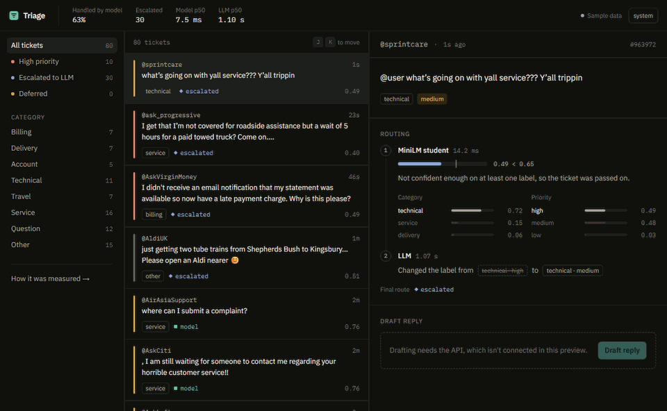
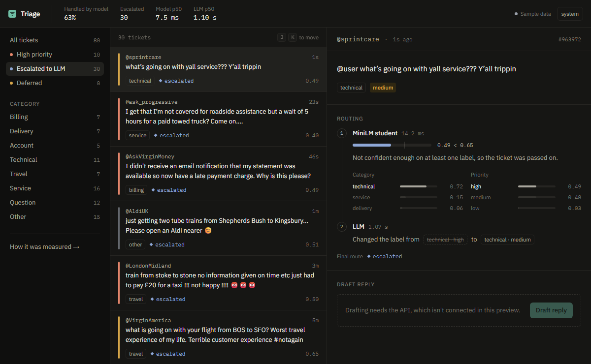
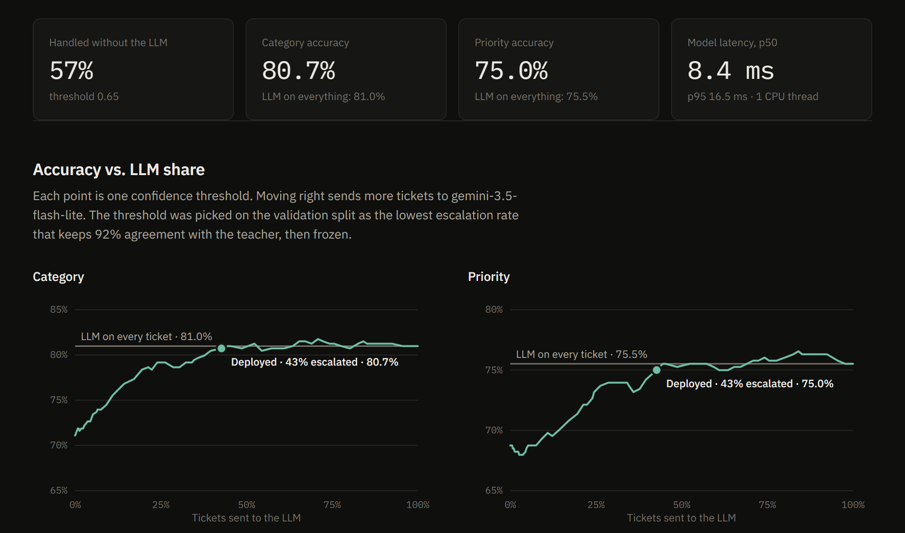
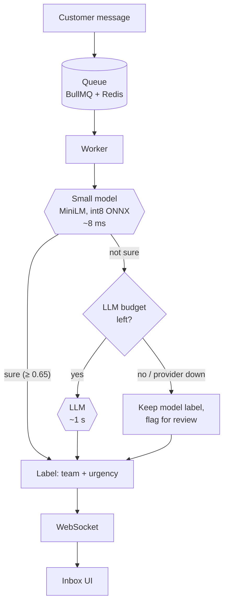
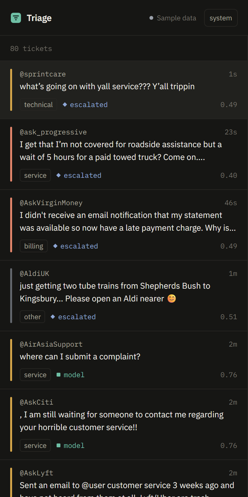
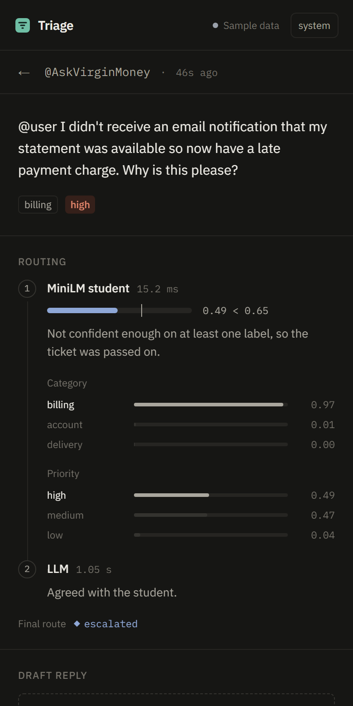

# Triage

**A support inbox that answers most tickets with a small, fast model and calls an LLM only when it has to.**

[](https://github.com/rudraksh01-tech/triage/actions/workflows/ci.yml)
[](https://triage-rho-eight.vercel.app)
[](LICENSE)

**[Live demo](https://triage-rho-eight.vercel.app)** · **[Demo video (0:41)](https://triage-rho-eight.vercel.app/demo.mp4)** · [Results page](https://triage-rho-eight.vercel.app/metrics) · [Follow one ticket](#follow-one-ticket) · [Run it](#run-it)



<p align="center"><sub>Full-quality video: <a href="https://triage-rho-eight.vercel.app/demo.mp4">watch in the browser</a> (41 s)</sub></p>

| Result on 384 held-out tickets | |
|---|---|
| Tickets handled without calling the LLM | **57%** |
| Accuracy compared with sending every ticket to the LLM | **0.3 points lower** (80.7% vs 81.0%) |
| Time for the small model to label a ticket | **8 ms** on one laptop CPU core |
| Model size after compression | **23 MB** |

<details>
<summary><b>Contents</b></summary>

- [The idea in one minute](#the-idea-in-one-minute)
- [Follow one ticket](#follow-one-ticket)
- [Results](#results)
- [How it works](#how-it-works)
- [The words, in plain English](#the-words-in-plain-english)
- [Built with](#built-with)
- [Engineering notes](#engineering-notes)
- [Tried and dropped](#tried-and-dropped)
- [Performance](#performance)
- [Run it](#run-it)
- [How much to trust these numbers](#how-much-to-trust-these-numbers)
- [Questions people ask](#questions-people-ask)

**Deeper documents**

- [Architecture](docs/architecture.md): every component, one ticket end to end, failure handling, scaling
- [Model card](docs/model-card.md): training setup, per-label scores, where and why the model goes wrong
- [API reference](docs/api.md): endpoints with real requests and responses, every setting

</details>

| Read this if you want to know... | |
|---|---|
| what the project does, in plain words | [The idea in one minute](#the-idea-in-one-minute), [Follow one ticket](#follow-one-ticket) |
| whether it works | [Results](#results), [Performance](#performance) |
| how it's built and why | [How it works](#how-it-works), [Engineering notes](#engineering-notes), [Architecture](docs/architecture.md) |
| how good the model really is | [Model card](docs/model-card.md), [How much to trust these numbers](#how-much-to-trust-these-numbers) |
| how to run or call it | [Run it](#run-it), [API reference](docs/api.md) |

## The idea in one minute

Support teams get thousands of messages a day: *"my parcel never arrived"*, *"I was charged twice"*,
*"the app keeps crashing"*. Each one has to be sorted (which team? how urgent?) before anyone can help.

An LLM sorts them well, but it is slow (about a second per ticket), every call costs money, and free
tiers run out. Most tickets are easy, though. So Triage works like a hospital triage desk:

1. A **small model** I fine-tuned reads every ticket in about **8 milliseconds**.
2. It also says **how sure it is**. If it's sure, its answer is final.
3. If it isn't, the ticket goes to the **LLM**, the senior doctor.

The small model learned from the LLM's own answers, and its confidence is calibrated, so "90% sure"
really means right about 90% of the time. That is what makes it safe to let it decide alone.

## Follow one ticket

**An easy one.** *"When @TacoBellTeam messes up your order twice in a row and you can't actually eat
it because they put meat when you're a #vegetarian."*

The small model reads it in 12 ms: **delivery** (89% sure), **medium** priority. Its overall confidence
is 0.76, above the 0.65 threshold, so that's the final answer. The LLM is never called.

**A hard one.** *"what's going on with yall service??? Y'all trippin"*



1. **Small model, 14 ms.** Category: **technical** at 72%. Priority: a coin toss, **high 49%** vs
   **medium 48%**.
2. **Routing.** Confidence is the weaker of the two answers, 0.49. That's below 0.65, so the
   ticket is passed on.
3. **LLM, 1.07 s.** It reads the same message and answers *technical, medium*: the complaint is vague
   and nothing is on fire.
4. **Result.** The inbox shows the final label, what the small model guessed, and that the LLM changed it.

Every ticket gets an answer from the small model. The LLM is only asked when that answer is shaky.
If the LLM is unavailable, the small model's answer is kept and the ticket is flagged for a person.

## Results

Measured on 384 held-out tickets that were never used for training or tuning:

| | Category accuracy | Priority accuracy | Tickets that needed the LLM |
|---|---|---|---|
| Keyword baseline (TF-IDF + logistic regression) | 63.0% | 64.1% | none |
| Fine-tuned MiniLM on its own | 71.1% | 68.8% | none |
| **Triage (small model + LLM when unsure)** | **80.7%** | **75.0%** | **43%** |
| LLM on every ticket (Gemini 3.5 Flash-Lite) | 81.0% | 75.5% | 100% |

**Why the hand-off works:** when the small model is sure, it is right **81%** of the time on category,
as good as the LLM. When it isn't sure, it is right only **57%** of the time. Its confidence tells you
which tickets to send on.



**Reading the chart.** Left edge: no ticket goes to the LLM (71%). Right edge: every ticket does (81%).
The curve climbs quickly and then flattens: the first 43% of tickets sent on, the least confident
ones, recover almost all of the gap. Sending the rest adds cost and almost no accuracy.

The threshold is a dial. At 0.55, only 25% of tickets go to the LLM and accuracy is 79.2% / 73.2%.
The [results page](https://triage-rho-eight.vercel.app/metrics) has the full curve, with hover.

## How it works



**How the small model was made**

| Step | What happens | Code |
|---|---|---|
| 1. Collect | 125,463 real customer tweets to 101 companies; phone numbers, emails and links masked | `ml/src/prepare.py` |
| 2. Teach | The LLM labels 20,000 of them: 8 categories, 3 priority levels | `ml/src/label.py` |
| 3. Learn | MiniLM is fine-tuned on those labels: one shared encoder, two small output heads | `ml/src/train.py` |
| 4. Calibrate | Confidence is rescaled to match real accuracy; the threshold is picked on validation data | `ml/src/calibrate.py` |
| 5. Compress | Exported to ONNX, quantized to int8 (91 MB to 23 MB), checked against PyTorch | `ml/src/export.py` |
| 6. Measure | Every model scored on a separate held-out set | `ml/src/baseline.py`, `calibrate.py` |

**Drafting a reply.** The dataset contains each company's real first reply. For a new ticket the API
finds the most similar past tickets from the same company and shows three of them, with the agent's
real answers, to the LLM as examples. The draft follows the company's tone: for a mouldy-food complaint
to a supermarket it asked for *"your receipt, the product details, and the batch code"*.

## The words, in plain English

| Term | What it means here |
|---|---|
| **LLM** | A large general-purpose language model (here Gemini). Smart, but slow and paid per call. |
| **Fine-tuning** | Taking a small pre-trained model and training it further on one specific job: sorting tickets. |
| **Teacher and student** | The LLM labels the training data (teacher); the small model learns to copy it (student). Also called distillation. |
| **Confidence** | The model's own probability for its answer. 0.9 means "I'm 90% sure". |
| **Calibration** | Adjusting confidence so it's honest: of all answers given at 0.9, about 90% should be right. |
| **Threshold** | The confidence cut-off (0.65). Above it, the small model decides; below, the LLM does. |
| **Cascade** | Cheapest model first, a stronger one only when needed. |
| **LoRA** | Fine-tuning by training a tiny add-on (0.7% of the weights) instead of the whole model. |
| **ONNX, int8** | A portable format for running models fast, and storing weights as 8-bit integers to shrink them 4×. |
| **Queue** | A waiting line for tickets, so a sudden flood is processed steadily instead of crashing the service. |
| **WebSocket** | A connection that stays open, so new tickets appear in the browser without refreshing. |
| **Embedding search** | Turning text into numbers so that similar messages end up close together, then finding the nearest ones. |
| **Deferred** | The LLM was needed but unavailable, so the small model's answer was kept and the ticket flagged. |

## Built with

| Layer | Tools |
|---|---|
| Model training | PyTorch (hand-written training loop), Hugging Face Transformers, PEFT/LoRA, scikit-learn |
| Serving | ONNX Runtime (int8), FastAPI, async httpx |
| LLM | Gemini 3.5 Flash-Lite through its OpenAI-compatible API |
| Reply drafting | bge-small embeddings (fastembed) over 19,615 real agent replies |
| Realtime | BullMQ, Redis pub/sub, WebSockets (Node, TypeScript) |
| Frontend | Next.js 16, React 19, TypeScript, Tailwind CSS, hand-built SVG charts |
| Quality | pytest, Playwright (desktop and phone), GitHub Actions, open-loop load testing |
| Deployment | Vercel (frontend), Docker Compose, notes for AWS EC2 + S3 |

<p align="center">
  
  &nbsp;&nbsp;
  
</p>

## Engineering notes

The decisions an interviewer would ask about, each with the number behind it.

**Why MiniLM instead of DistilBERT.** DistilBERT was the plan, but on this laptop (2 CPU cores, no
GPU) it trained at 15 seconds per step, about 8 hours. MiniLM-L6 is a third of the size and ran at
1.2 s per step. Grouping tweets of similar length into each batch and trimming the padding halved it
again. `train.py --base distilbert-base-uncased` still works on a GPU.

**One model, two answers.** Category and priority share the same encoder, each with its own small
output layer, trained with a summed loss: half the compute of two models and one file to serve.
"High" priority is rare, so its loss is weighted up (inverse square root of frequency; full balancing
hurt precision).

**Full fine-tuning vs LoRA.** LoRA trains 151,691 parameters instead of 22.7 million (0.7%) and lands
in the same place: 71.9% / 67.2% vs 71.1% / 68.8%. The full model is served because it needed fewer
LLM calls for the same accuracy (43% vs 47%).

**Making confidence honest.** Temperature scaling, fitted on validation data, cut calibration error
on the held-out set from 0.108 to 0.066 (category) and 0.126 to 0.077 (priority).

**Choosing the threshold without peeking.** It was picked on the validation split as the lowest LLM
share that keeps 92% agreement with the teacher, and frozen before the held-out set was scored.

**A silent bug caught by a parity check.** The first ONNX export agreed with PyTorch on only 92% of
tickets, in full precision where it should be 100%. The old exporter had baked the example input's
length into the attention-mask maths, so any batch of a different length came out wrong, while single
tickets looked fine. The newer `dynamo` exporter fixed it: 100% in fp32, 97% label agreement after
int8, and no loss in accuracy. The export script now always runs that check.

**Failing gracefully.** The LLM free tier allows 15 requests a minute. The API keeps its own
one-minute budget; when it's spent, or the provider errors, the ticket keeps the model's label and is
flagged `deferred` instead of blocking the queue. A rate-limit response opens a circuit breaker for as
long as the provider asks (an hour for a daily quota), so a dead provider costs one request, not one
per ticket. This was tested for real: the daily quota ran out during a demo and every ticket kept
getting labelled.

**Replies grounded in real answers.** Only training tickets are searchable for reply examples, so a
demo ticket can never retrieve its own answer.

## Tried and dropped

Both are still in the code, switched off, with the measurements that turned them off.

**Cross-encoder reranking.** For 300 held-out tickets with a known company reply, the top retrieved
reply was compared to the real one (cosine similarity; a proxy, not a human rating):

| Retrieval | Similarity to the real reply | Same company | Time per query |
|---|---|---|---|
| Random past reply | 0.648 | 1% | – |
| Embedding search | 0.714 | 67% | 21 ms |
| **Embedding search + same-company boost** (used) | **0.723** | **93%** | **21 ms** |
| Cross-encoder rerank | 0.715 | 73% | 692 ms |
| Rerank + same-company boost | 0.715 | 76% | 700 ms |

The reranker was 33 times slower for no gain. A model trained on web search doesn't know that "how
Amazon replies" matters more than word overlap; a small bonus for the same company did more.

**Micro-batching.** Grouping concurrent requests into one model call usually raises throughput. Here
it lowered peak throughput from 84 to 62 requests a second and doubled light-load latency (11 to 26 ms).
Batches averaged 1.3 tickets and ran one at a time, while unbatched requests used both cores. On this
machine the HTTP overhead, not the model, is the bottleneck. `TRIAGE_MAX_BATCH=32` turns it on for a GPU.

## Performance

**Model speed**, one ticket at a time on one CPU thread:

| Runtime | Size | Median | 95th percentile |
|---|---|---|---|
| PyTorch | – | 31 ms | 45 ms |
| ONNX | 91 MB | 17 ms | 32 ms |
| **ONNX int8** (used) | **23 MB** | **8 ms** | **16 ms** |

**API under load.** Requests fired on a fixed schedule, so a slow server shows up as latency; LLM
calls off; load generator on the same 2-core laptop:

| Target | Achieved | Failed | Median | 95th | 99th |
|---|---|---|---|---|---|
| 20 req/s | 20 | 0 | 11 ms | 20 ms | 27 ms |
| 50 req/s | 50 | 0 | 16 ms | 34 ms | 44 ms |
| 100 req/s | 100 | 0 | 20 ms | 42 ms | 57 ms |
| 200 req/s | 84 | 0 | 8.8 s | 26 s | 30 s |

Capacity tops out near 90 requests a second; beyond that requests pile up. That is the queue's job:
in the outage simulation, 300 tickets arriving at once were cleared in under 5 seconds.

## Run it

**Just the frontend** (Node 22). Shows the 80 measured sample tickets and the results page:

```bash
cd web && npm install && npm run dev        # http://localhost:3000
```

**The whole system**: live queue, outage simulation and reply drafts. Needs the trained model in
`ml/artifacts/` (see the pipeline below) and a free Gemini API key from
[Google AI Studio](https://aistudio.google.com):

```bash
cp .env.example .env                        # add the key
docker compose up --build                   # Redis, API on :8000, realtime on :8080
cd web && NEXT_PUBLIC_API_URL=http://localhost:8000 \
          NEXT_PUBLIC_REALTIME_URL=http://localhost:8080 npm run dev
```

Without Docker: `uvicorn triage_api.main:app` in `api/`, `npm run dev` in `realtime/`, and a local
Redis on port 6379.

<details>
<summary><b>Rebuilding the model from scratch</b> (about 2 hours on a laptop CPU)</summary>

Download the [Customer Support on Twitter](https://www.kaggle.com/datasets/thoughtvector/customer-support-on-twitter)
dataset to `ml/data/raw/twcs.csv`, then:

```bash
python -m venv .venv && source .venv/bin/activate   # Windows: .venv\Scripts\activate
pip install torch --index-url https://download.pytorch.org/whl/cpu
pip install pandas pyarrow scikit-learn transformers peft onnx onnxscript onnxruntime fastembed httpx python-dotenv
pip install -e "api[dev]"

python ml/src/prepare.py                 # clean, mask personal data, cap per company
python ml/src/split.py                   # held-out / train / replay stream
python ml/src/label.py train --batch 50 --workers 3   # LLM labels; resumable
python ml/src/label.py gold
python ml/src/baseline.py --teacher gemini-3.5-flash-lite
python ml/src/train.py --name full
python ml/src/train.py --name lora --lora
python ml/src/calibrate.py --run full
python ml/src/export.py --run full
python ml/src/replies.py && python ml/src/index.py
python ml/src/eval_retrieval.py
python ml/src/publish.py --run full --lora-run lora  # writes the numbers the web app shows
```

</details>

<details>
<summary><b>Deploying the backend</b></summary>

[`deploy/aws.md`](deploy/aws.md) walks through one EC2 instance with Docker Compose, model files in
S3 (so a new model ships by uploading files), HTTPS with Caddy, and the frontend on Vercel.

</details>

<details>
<summary><b>Where things are</b></summary>

```
ml/src/
  prepare.py         raw tweets -> clean tickets, personal data masked
  split.py           held-out / train / replay stream
  label.py           LLM teacher labels, resumable and rate-limit aware
  baseline.py        TF-IDF + logistic regression
  train.py           PyTorch fine-tuning, full or LoRA
  calibrate.py       temperature scaling, threshold, accuracy-vs-LLM-share curve
  export.py          ONNX export, int8 quantization, parity and speed checks
  replies.py         ticket -> real agent reply pairs
  index.py           embeddings for reply search
  eval_retrieval.py  is reranking worth it?
  publish.py         measured numbers -> web app
api/triage_api/
  main.py            /v1/classify, /v1/classify/batch, /v1/draft, /health
  student.py         ONNX model + calibrated confidence
  llm.py             LLM client: budget, cache, retry, circuit breaker
  drafts.py          reply retrieval and prompt
  batcher.py         micro-batching (off by default, see above)
realtime/src/
  replay.ts          replays real tickets, outage bursts
  worker.ts          queue consumer -> API -> Redis pub/sub
  gateway.ts         WebSocket + /burst endpoint
web/src/
  components/        inbox, routing panel, reply drafts, results chart
  app/metrics/       results page
loadtest/run.py      open-loop load generator
```

</details>

## Tests

```bash
cd api && pytest                  # routing, budget, circuit breaker, batching, input validation
cd web && npx playwright test     # inbox, keyboard, filters, theme, results chart, phone layout
cd realtime && npm run typecheck
```

All three run on every push, plus a container build, in [GitHub Actions](.github/workflows/ci.yml).

## How much to trust these numbers

- **The held-out labels come from an LLM, not people.** They were written by a separate, stronger
  general-purpose LLM, independent of both Gemini models: a strong second opinion, not ground truth.
  `ml/tools/review.py` is a blind labelling tool for adding human labels; every script takes `--gold human`.
- **The teacher sets the ceiling.** The small model can't learn what the teacher gets wrong, and the
  fallback is the same LLM, so Triage tops out near 81%. Gemini 3.5 Flash scored 87% on the tickets it
  managed before its 20-requests-a-day free limit ran out; a stronger fallback would raise the ceiling.
- **The curve was measured on the PyTorch model.** The served int8 model agrees with it on 97% of
  labels, so served numbers are very close but not identical.
- **The data is from 2017** and mostly US and UK companies.

## Questions people ask

**Why not just send everything to the LLM?** It works, but costs a call per ticket and takes about a
second each. Triage gets the same accuracy within 0.3 points with 57% fewer calls, and the 57% it
handles alone come back in milliseconds.

**Why not use the small model alone?** It's 10 points less accurate on its own (71% vs 81%), and the
mistakes concentrate in exactly the tickets it is unsure about. The cascade spends the LLM where it
actually helps.

**Why train on LLM labels instead of human ones?** Labelling 20,000 tickets by hand takes weeks.
The LLM did it in about an hour. The trade-off is that the small model inherits the LLM's mistakes,
which is why it's measured against a separate set of labels.

**Why tweets?** They are real customer messages with real company replies, publicly available, and
messy in the way real tickets are: slang, typos, emoji, several complaints at once.

**Is it production-ready?** The service handles ~90 requests a second on a laptop, degrades gracefully
when the LLM is down, and is tested end to end. Before real use it would need human-labelled
evaluation data, authentication, per-customer rate limits and monitoring.

## What I'd do next

- Send `deferred` tickets back through the LLM once its budget frees up, using a rate-limited queue.
- Add human labels and revisit the categories: the most common mistakes are *service* vs *other*
  (20 of 111) and *question* vs *travel* (8), which look like fuzzy boundaries more than model errors.
- Try a stronger fallback model than the teacher.

## Credits and license

Data: [Customer Support on Twitter](https://www.kaggle.com/datasets/thoughtvector/customer-support-on-twitter)
by Thought Vector, CC BY-NC-SA 4.0, so the derived labels and models are for non-commercial use.
Code: [MIT](LICENSE).
