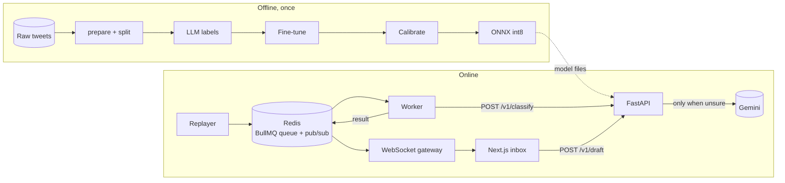
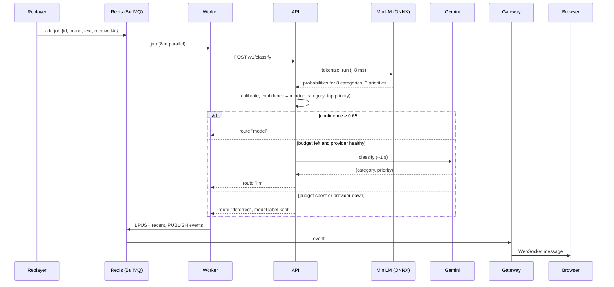

# Architecture

Three services and a store, plus an offline training pipeline.

| Component | Language | Job | Code |
|---|---|---|---|
| Training pipeline | Python | Turns raw tweets into a calibrated, quantized model and every number in the README | `ml/src/` |
| API | Python, FastAPI | Classifies a ticket, decides whether to ask the LLM, drafts replies | `api/triage_api/` |
| Realtime | TypeScript, Node | Replays real tickets into a queue, works through it, pushes results to browsers | `realtime/src/` |
| Redis | – | BullMQ job queue, recent-ticket list, pub/sub channel | `docker-compose.yml` |
| Web | TypeScript, Next.js | Inbox, routing panel, reply drafts, results page | `web/src/` |

## One ticket, end to end

1. **Replayer** (`realtime/src/replay.ts`) reads 4,000 real held-out tweets and adds one to the
   queue roughly every 2 seconds, with jitter. `POST /burst` adds 300 at once to simulate an outage,
   at most once a minute.
2. **Queue.** BullMQ on Redis. Each job retries 3 times with exponential back-off; finished jobs are
   trimmed to the last 1,000.
3. **Worker** (`realtime/src/worker.ts`) takes 8 jobs at a time and calls the API with a 30 s timeout.
4. **API** (`api/triage_api/main.py`) runs the ONNX model in a thread so the event loop stays free,
   applies the per-head temperatures, and takes the weaker of the two confidences. If it is at least
   the threshold, that's the answer.
5. **LLM fallback** (`api/triage_api/llm.py`) checks, in order: is the circuit breaker open, is there
   budget left this minute, is the answer cached. Then it calls Gemini with the label definitions and
   validates that the reply is one of the known labels.
6. **Result.** The worker stores the ticket in a capped Redis list (the last 200) and publishes it.
7. **Gateway** (`realtime/src/gateway.ts`) sends a snapshot of recent tickets to each new browser,
   then streams new ones, plus queue depth once a second.
8. **Browser** (`web/src/lib/live.ts`) reconnects with exponential back-off (1 s to 30 s) and falls
   back to the bundled sample tickets if no gateway is configured.

## When things go wrong

| Failure | What happens | Where |
|---|---|---|
| LLM over its per-minute budget | Ticket keeps the model's label, route `deferred` | `llm.py` `RateLimiter` |
| LLM returns 429 | Circuit opens for the time the provider asks (an hour for a daily quota); no calls until then | `llm.py` `open_circuit` |
| LLM returns 500/502/503 | One retry after 400 ms, then `deferred` | `llm.py` `chat` |
| LLM returns a label that doesn't exist | Treated as a failure, `deferred` | `llm.py` `classify` |
| API down or slow | Job retried 3 times with back-off, then marked failed; queue keeps the rest | `replay.ts` `JOB_OPTS` |
| Traffic spike | Requests wait in the queue instead of overloading the API | BullMQ |
| Slow browser | Gateway stops sending to a client with more than 1 MB buffered | `gateway.ts` |
| Browser loses connection | Reconnects with back-off; shows "Reconnecting" | `live.ts` |
| No backend at all | Web app shows 80 pre-measured tickets and labels itself "Sample data" | `live.ts` |
| Unknown website calls the API | Rejected by CORS; gateway closes WebSockets from other origins | `main.py`, `gateway.ts` |

## Decisions and their trade-offs

| Decision | Why | Cost |
|---|---|---|
| Two heads on one encoder | Half the compute, one artifact | Tasks can't specialise their encoders |
| Confidence = min of the two heads | A ticket is only "easy" if both answers are | Escalates some tickets where only priority is unclear |
| Threshold chosen on validation | No peeking at the evaluation set | Validation labels come from the teacher itself |
| int8 quantization | 4× smaller, 2× faster | 3% of labels differ from fp32 |
| LLM budget per process | Simple, no shared state | With several API replicas the budget multiplies; would move to Redis |
| Queue between replayer and API | Absorbs bursts; retries | One more moving part to run |
| Sample-data fallback in the web app | The hosted demo works with no backend and can't burn API quota | Hosted demo isn't live |
| Reranker and micro-batching off | Measured slower with no gain on this hardware | Kept in code, behind flags |

## Scaling notes

On a 2-core laptop the API holds about 90 requests a second at a 42 ms 95th percentile (see the
README). Beyond that:

- **More API replicas** behind a load balancer; the model is read-only and 23 MB, so each replica
  loads it independently. The LLM budget and circuit state would move to Redis so replicas share them.
- **More workers** with higher BullMQ concurrency; the queue already decouples arrival rate from
  processing rate.
- **Micro-batching** (`TRIAGE_MAX_BATCH`) becomes worth it on a GPU, where one batched call is far
  cheaper than many single ones. On this CPU it lowered throughput.
- **Deferred tickets** should go to a second, rate-limited queue that re-asks the LLM once budget frees up.
